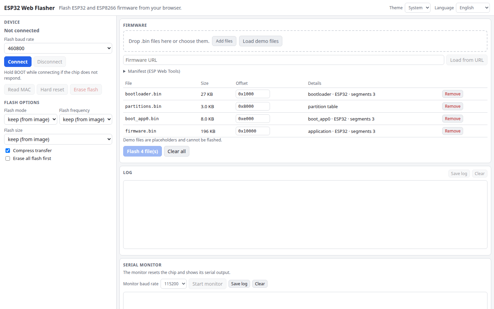

# ESP32 Web Flasher

Flash ESP32 and ESP8266 firmware straight from the browser. Connect over Web Serial, read the chip info and MAC address, write several `.bin` files at their offsets, erase the flash, and watch the serial monitor afterwards. Files come from disk, a URL or an ESP Web Tools manifest. It is built on [esptool-js](https://github.com/espressif/esptool-js) and runs entirely in your browser: firmware never leaves your computer.

**Try it: [hermes98761234.github.io/esp32-web-flasher](https://hermes98761234.github.io/esp32-web-flasher/)**

[](https://github.com/hermes98761234/esp32-web-flasher/actions/workflows/deploy.yml)



## Features

- **Connect and identify.** Chip model and revision, features, crystal frequency, MAC address and detected flash size. Reads the MAC again on demand.
- **Multi-file flashing.** Add files by picking or dropping them; offsets are suggested from the file name and the connected chip (bootloader, partition table, `boot_app0`, app) and are editable (`0x1000`, `4096`, `64k`).
- **Safety checks before writing.** Overlapping files, bad or non-4 KB-aligned offsets, images larger than the detected flash, and images built for a different chip are flagged.
- **Options.** Baud rate up to 1.5 Mbaud, flash mode, frequency and size, compressed transfer, erase-all-first, and a standalone Erase flash button. Data is MD5-verified by esptool-js.
- **Load from anywhere.** Local files, a URL (the server must allow CORS), or an [ESP Web Tools](https://esphome.github.io/esp-web-tools/) manifest by URL or file. The build for the connected chip is picked automatically.
- **Serial monitor.** After flashing, the chip is reset into the app. You can start the monitor at any baud rate, send text with a chosen line ending, and save the logs.
- **Progress and log.** Per-file and overall progress bar plus the full esptool log.
- **English and Ukrainian, light/dark/system theme**, settings remembered in the browser. No backend, no tracking.

## How it works

The page uses the Web Serial API to open the port, resets the chip into the ROM bootloader with the usual DTR/RTS sequence, uploads the esptool-js flasher stub, and optionally raises the baud rate. Files are padded, deflated and streamed in blocks, and the MD5 of each image is checked. A hard reset then starts the new firmware. The monitor reopens the same port at the app baud rate and decodes the stream as text.

Supported chips are those supported by esptool-js: ESP8266, ESP32, S2, S3, C2, C3, C5, C6, C61, H2 and P4. Web Serial is available in Chrome, Edge and Opera on desktop (over HTTPS or localhost). Firefox and Safari can only prepare files. Everything is bundled, with no CDN dependencies.

Demo files are synthetic placeholders so the page shows something on first load. They cannot be flashed. Not tested against real hardware in CI.

## Quick start

You need [Node.js](https://nodejs.org/) 22.

```bash
git clone https://github.com/hermes98761234/esp32-web-flasher.git
cd esp32-web-flasher
npm install
npm run dev       # http://localhost:5173
npm test          # md5, offsets, image/layout/manifest/monitor/i18n tests
npm run build     # static site in dist/
```

## License

MIT
